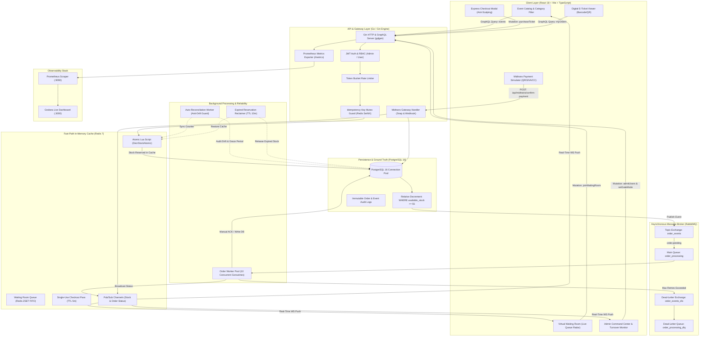

# Technical Architecture & Engineering Details: Flash Sale Platform

The problem background and business impact of this project are described in the Summary document.

## Scope of Engineering

The technical scope encompasses end-to-end architectural design and implementation across the full transaction lifecycle:
- High-throughput modular backend engineered with Go, the Gin web framework, and GraphQL (gqlgen), organized with strict architectural boundaries (handlers, services, repository interfaces, data models, background workers, and middleware).
- Relational database schema design in PostgreSQL spanning four core tables (users, events, orders, and order_logs) with version-controlled migrations (golang-migrate), performance indexing, and immutable audit logging.
- Dual-layer inventory concurrency control: fast-path in-memory atomic quota decrement via Redis Lua scripting (DecrStockAtomic) and ACID conditional SQL locking in PostgreSQL (UPDATE events SET available_stock = available_stock - $1 WHERE id = $2 AND available_stock >= $1).
- Absolute idempotency guarantees for ticket checkout mutations using an Idempotency-Key Mutex Guard backed by Redis SetNX with a 24-hour expiration window.
- Traffic surge smoothing via a Virtual Waiting Room built on Redis Sorted Sets (ZSET FIFO) featuring real-time queue position tracking, 5-minute single-use checkout passes, and dual-mode admission control (AUTO mode and MANUAL Surge Gate).
- Asynchronous message queuing architecture using RabbitMQ with a topic exchange (order_events), a 10-goroutine worker pool with manual acknowledgment, 3-tier exponential backoff retries, and poison-message isolation via a Dead-Letter Queue (order_processing_dlq).
- Automated self-healing background reconciliation worker (reconciliation_worker) tracking data drift, enforcing an active 2-minute in-flight grace period, and purging expired unpaid reservations older than 10 minutes.
- Integrated Midtrans Snap payment gateway module (sandbox/simulator) including Snap transaction token generation, a multi-method payment modal (QRIS, Bank Virtual Accounts, e-wallets, credit cards), asynchronous webhook processing, and atomic payment confirmation.
- Self-service digital ticket module (E-Ticket) rendering interactive barcodes and unique QR codes (TicketBarcode), validating ticket lifecycle states (ACTIVE, USED, CANCELLED), and providing printable digital receipts.
- Admin Command Center Dashboard for real-time turnover tracking, sales volume analytics, in-memory inventory monitoring, batch queue admission controls (admitUsers), and lifecycle transaction inspection via audit logs.
- Modern Single Page Application (SPA) web client developed with React 18, TypeScript (strict mode), Vite, TanStack Query, Tailwind CSS, and real-time WebSocket subscriptions (graphql-ws).
- Unified observability stack featuring a Prometheus metrics exporter (/metrics), automated Grafana live dashboards, distributed request tracing (X-Request-ID), k6 stress benchmark suites, and GitHub Actions CI/CD with Go race detector validation (-race).

## System Architecture

The system decouples fast-path in-memory inventory reservation from transactional database persistence, leveraging an asynchronous message broker to handle background workloads smoothly.

### Component Breakdown
1. **Web Client (React 18 SPA):** Responsive user interface built with TypeScript that manages a multi-category ticket catalog, an interactive waiting room modal with live radar queue tracking, express purchase forms, a multi-method payment simulator, an e-ticket barcode viewer, and an administrative analytics command center.
2. **Client State Architecture (TanStack Query & graphql-ws):** Separates synchronous request-response state (caching, query revalidation, and optimistic UI updates) from real-time WebSocket subscriptions handling live stock updates and order status changes.
3. **HTTP Router & Gateway (Gin Engine):** Directs incoming traffic across the GraphQL API endpoint (/query), Midtrans payment endpoints (/api/midtrans/*), the interactive GraphQL documentation playground, and the Prometheus metrics scraping endpoint (/metrics).
4. **Security & Tracing Middleware:** Injects unique Request IDs (X-Request-ID) into request contexts, validates 24-hour JWT tokens, and enforces Role-Based Access Control between Administrator and General User accounts.
5. **Rate Limiting Engine:** Enforces user purchase velocity limits (maximum 5 requests per 10 seconds) using a time-window counter in Redis to prevent purchase button spamming.
6. **Idempotency Mutex Guard:** Blocks duplicate orders spawned from the same user request using unique Redis keys initialized in a PROCESSING state, caching finalized order records for 24 hours.
7. **Fast-Path In-Memory Cache (Redis Engine):** Executes the DecrStockAtomic Lua script for microsecond zero-oversell stock reservations, maintains the FIFO waiting room queue via Sorted Sets, and manages 5-minute single-use checkout passes.
8. **Asynchronous Message Broker (RabbitMQ):** Manages the order_events topic exchange, routes pending orders to the main queue (order_processing), and isolates failed messages into the dead-letter queue (order_processing_dlq).
9. **Order Worker Pool:** A pool of 10 concurrent Go worker goroutines consuming messages in the background with manual delivery acknowledgments, controlled prefetch QoS limits, and graceful shutdown handling.
10. **Automated Reconciliation Worker:** Periodic background process (60-second interval) auditing cache counts against PostgreSQL confirmed tickets, protected by an in-flight grace period to prevent race conditions during active checkouts.
11. **Expired Reservation Reclaimer:** Detects PENDING orders exceeding the 10-minute payment threshold, cancels the orders, and restores stock to both the database and Redis cache automatically.
12. **Transactional Database (PostgreSQL 16 Pool):** High-performance connection pool (pgxpool) acting as the durable source of truth, enforcing ACID integrity via relative conditional SQL clauses and preserving immutable transaction audit logs.
13. **Payment Gateway Module:** Handles the payment lifecycle from Snap token generation and webhook notification reception to atomic order confirmation.
14. **Observability Stack (Prometheus & Grafana):** Collects internal application metrics every 2 seconds and visualizes throughput, latency distributions, queue depth, and remaining stock on central dashboards.

## Technical Decisions and Challenges

### 1. Rapid Quota Locking via Atomic Redis Lua Script (DecrStockAtomic)
- **Problem:** When thousands of concurrent users attempt to check out in the same second, executing updates directly against a relational database triggers intense row-lock contention, elevated latency, and severe race conditions that risk driving inventory negative.
- **Decision:** Inventory decrements execute first in Redis memory using a unified Lua script named DecrStockAtomic. This script checks available stock and executes decrements atomically in a single operation before any request touches the database.
- **Rationale and Trade-offs:** Because Redis runs single-threaded per command, Lua script execution is 100% atomic across concurrent goroutines and completes in microseconds. The trade-off is introducing a strict dependency on Redis as the fast-path gate, requiring robust compensating rollback logic if downstream steps fail.
- **Evidence:** Implemented in DecrStockAtomic within the redisclient package. Parallel integration tests running 50 concurrent goroutines competing for 10 tickets produced exactly 10 successful orders and 40 rejections. In a 500-VU k6 blitz stress test competing for 100 tickets, the system filtered transactions cleanly with exactly 0 remaining stock and zero overselling.

### 2. Secondary Protection via Conditional Relative SQL Decrements in PostgreSQL
- **Problem:** Sole reliance on in-memory caching introduces the risk of data divergence (data drift) between cache state and durable storage during network interruptions, application crashes, or unexpected cache server restarts.
- **Decision:** A secondary verification layer was implemented in PostgreSQL using a strict relative update clause:
  UPDATE events SET available_stock = available_stock - $1, updated_at = NOW() WHERE id = $2 AND available_stock >= $1.
  If the affected row count returns zero, the application aborts the order, triggers an atomic rollback in Redis (IncrStock), marks the order as cancelled, and logs the depletion event.
- **Rationale and Trade-offs:** Establishes the relational database as an immutable source of truth backed by ACID guarantees without needing to lock entire tables. The trade-off is the overhead of a two-phase stock deduction pattern (Redis followed by DB) and compensating rollback logic.
- **Evidence:** Implemented in DeductAvailableStock in the event repository. Integration tests confirmed that database stock exhaustion immediately rolls back the Redis counter. Post-benchmark database queries verified exactly 100 confirmed orders and exactly 0 remaining available stock.

### 3. Decoupling the Critical Path via a RabbitMQ Worker Pool
- **Problem:** Processing all transactional steps synchronously (validation, persistent logging, receipt generation, and payment gateway communication) inside a single HTTP request causes response times to spike severely during traffic surges.
- **Decision:** Checkout workflows were split into two paths: a critical path (fast-path stock reservation, pending order persistence, and instant client response) and an asynchronous non-critical path dispatched to RabbitMQ (order_processing queue) for background execution by a pool of 10 worker goroutines.
- **Rationale and Trade-offs:** Keeps client checkout latencies within hundreds of milliseconds and cushions the database against unthrottled write bursts. The trade-off is transitioning to an eventual consistency model, where users receive an initial pending status before confirmation is delivered via WebSocket.
- **Evidence:** The OrderWorkerPool operates with 10 concurrent goroutines using manual delivery acknowledgments (msg.Ack(false)) and QoS prefetch limiting (numWorkers * 2). Median latency remained at 276 milliseconds during the ramp-up stress test.

### 4. Fault Tolerance via Dead-Letter Queues and Exponential Backoff Retries
- **Problem:** Transient database locks or downstream service failures can disrupt message processing in asynchronous queues. Without proper controls, failing messages risk being dropped or causing poison-pill crash loops.
- **Decision:** RabbitMQ was configured with a Dead-Letter Exchange (order_events_dlx) and Dead-Letter Queue (order_processing_dlq). Failed messages undergo up to 3 retry attempts with progressive exponential backoff delays. If all retries fail, the message is routed to the DLQ and recorded in audit logs.
- **Rationale and Trade-offs:** Keeps the primary queue unclogged while preserving problematic transactions for investigation and reprocessing. The trade-off is that DLQ entries require secondary inspection or dedicated replay mechanisms.
- **Evidence:** Integration test TestIntegration_RetryBackoffAndDLQ verified that deliberately faulted messages traversed all 3 retry cycles with exponential delays before arriving safely in order_processing_dlq.

### 5. Absolute Idempotency Enforcement via Redis Idempotency Mutex Guard
- **Problem:** Anxious buyers frequently click purchase buttons repeatedly when experiencing network delays, which can spawn duplicate orders and consume multiple tickets unintentionally.
- **Decision:** An idempotency mutex guard was built using Redis SetNX with an initial PROCESSING state and a 24-hour TTL on finalized order results. If a duplicate request with the same idempotency key arrives, the system halts duplicate processing and returns the completed order record once ready.
- **Rationale and Trade-offs:** Eliminates duplicate execution at the gateway layer before quota checks are evaluated. The trade-off is requiring client applications to generate and pass unique idempotency keys with every checkout mutation.
- **Evidence:** Implemented in AcquireIdempotencyLock and SaveIdempotencyResult. Parallel integration tests running 10 concurrent goroutines with identical idempotency keys confirmed that exactly one order was created and only a single ticket quota was deducted.

### 6. Traffic Surge Smoothing via Virtual Waiting Room (Redis Sorted Set)
- **Problem:** Sudden flash sale traffic spikes can overwhelm application instances before users have navigated to active event pages.
- **Decision:** A virtual waiting room was constructed using Redis Sorted Sets (ZSET) scored by arrival timestamps in milliseconds to maintain strict FIFO fairness. Admitted users receive a cryptographic single-use checkout pass valid for 5 minutes. The gate mode supports both automatic flow (AUTO) and manual surge regulation (MANUAL).
- **Rationale and Trade-offs:** Absorbs peak visitor loads in a lightweight in-memory structure without stressing the core checkout path. The trade-off is an extra waiting step for prospective buyers prior to payment.
- **Evidence:** Implemented in JoinWaitingRoom, AdmitNextBatch, and HasCheckoutPass. Waiting room modal component tests passed with zero errors, and Playwright end-to-end browser tests verified the complete user flow from joining the queue to receiving admission and completing checkout.

### 7. Automated Inventory Reconciliation with In-Flight Grace Period
- **Problem:** Count discrepancies (data drift) between cache counters and database rows can accumulate over time due to unhandled network drops or unexpected worker restarts.
- **Decision:** A background reconciliation worker runs every 60 seconds, aggregating confirmed tickets in PostgreSQL and comparing the total against the Redis counter. An in-flight grace period guard checks whether transactions were initiated within the last 2 minutes, preventing premature upward adjustments while orders are actively processing.
- **Rationale and Trade-offs:** Automatically guarantees long-term inventory consistency without manual operational intervention. The trade-off is running periodic aggregation queries against the relational database.
- **Evidence:** Implemented in reconciliation_worker.go. Expired reservation tests demonstrated automated stock restoration, and post-blitz database audits confirmed that total stock minus confirmed orders perfectly matched available inventory.

### 8. Decoupling the Payment Lifecycle from Quota Reservation via Midtrans Integration
- **Problem:** Online payment settlement requires external user interaction (scanning QR codes or entering bank details). Holding inventory permanently prior to settlement risks freezing quotas for valid buyers if payments are abandoned.
- **Decision:** The transaction lifecycle was decoupled: checkout reservations instantly secure ticket stock under a PENDING status and issue a Midtrans Snap token. Successful settlements via webhook or client confirmation transition the order to CONFIRMED. If unpaid after 10 minutes, the reservation expires and stock is returned to the public pool automatically.
- **Rationale and Trade-offs:** Guarantees that inventory is not locked indefinitely by abandoned carts while maintaining quota availability accuracy. The trade-off is managing asynchronous payment state synchronization and timeout reconciliations.
- **Evidence:** Endpoints /api/midtrans/snap-token, /api/midtrans/webhook, and /api/midtrans/confirm-payment in main.go, paired with the CancelExpiredOrders implementation in checkout service.

### 9. Dual-Channel Real-Time Communication Combining TanStack Query and GraphQL WebSocket
- **Problem:** Polling HTTP endpoints repeatedly to display live ticket counts and queue numbers to thousands of users overwhelms web servers with inefficient, redundant requests.
- **Decision:** Synchronous transactions are managed via TanStack Query, while live mutations (stockUpdated and orderStatusChanged) are delivered over persistent WebSocket connections (graphql-ws). The backend publishes updates through Redis Pub/Sub channels that relay directly to connected clients.
- **Rationale and Trade-offs:** Eliminates HTTP polling overhead and delivers sub-second UI updates. The trade-off is maintaining stateful open socket connections at the gateway server.
- **Evidence:** Implemented via srv.AddTransport(transport.Websocket{}) in main.go, GraphQL subscription resolvers, and graphql-ws client integration on the frontend.

### 10. Forensic Transaction Auditing via Immutable Order Audit Logs
- **Problem:** High-contention flash sales frequently lead to customer disputes where buyers claim they secured tickets before a sellout occurred.
- **Decision:** An append-only audit ledger (order_logs) was implemented to record every lifecycle event alongside full JSON payloads (ORDER_CREATED, STOCK_RESERVED, ORDER_AWAITING_PAYMENT, ORDER_CONFIRMED, ORDER_DLQ_ROUTED, DB_STOCK_DEPLETED_ROLLBACK, RESERVATION_EXPIRED, MIDTRANS_PAYMENT_CONFIRMED).
- **Rationale and Trade-offs:** Provides an tamper-proof forensic trail for technical reconciliation and customer support resolution. The trade-off is faster storage growth for audit tables compared to core transaction records.
- **Evidence:** Methods CreateOrderLog and GetOrderLogsByOrderID in the order repository, combined with the administrative audit log viewer in the frontend dashboard.

## Testing Results & Observability

### 1. Real-World Stress Test Benchmarks (k6)
Stress testing was executed using k6 on an ARM64 10-core hardware environment with 16 GB of memory, connecting the Go application to containerized instances of PostgreSQL 16, Redis 7, and RabbitMQ 3.

| Benchmark Scenario | Virtual Users (VUs) | Total Completed Transactions | Average Throughput | Median Latency | p(95) Latency | HTTP Error Rate | Successful Ticket Sales | Overselling Rate |
|---|---|---|---|---|---|---|---|---|
| **Ramp-Up (Gradual Load)** | 0 to 200 users over 35s | 2,433 iterations (4,868 HTTP req) | 138.6 req/s | 276 ms | 1,145 ms | **0.00%** | 500 / 500 tickets | **0 (0%)** |
| **Sudden Spike (Thundering Herd)** | 10 to 300 users in 2s | 1,503 iterations (3,008 HTTP req) | 119.4 req/s | 2,468 ms | 4,170 ms | **0.00%** | 500 / 500 tickets | **0 (0%)** |
| **Flash Sale Blitz (High Contention)** | 500 concurrent users | 2,000 iterations (4,003 HTTP req) | 134.9 req/s | 4,545 ms | 6,887 ms | **0.00%** | 100 / 100 tickets | **0 (0%)** |

### 2. Post-Blitz Database Ground Truth Verification
Audits conducted directly on the database tables following 2,000 checkout attempts:
- Confirmed order records: exactly 100 orders representing 100 tickets.
- Available stock remaining on the event record: exactly 0 tickets out of 100 initial stock.
- Cleanly rejected requests: 1,900 requests received graceful sold-out responses without internal server errors.
- Overselling rate: 0 tickets (mathematically verified zero overselling).

### 3. Automated Test Suites and Code Quality
- **Unit Testing:** Table-driven business logic suites covering pricing validation, anti-scalping quota rules, event status boundaries, queue metrics, and reservation timeouts completed in 0.21 seconds.
- **Integration Testing with Race Detector (-race):** Concurrency suites verifying 50 parallel buyers, 10 duplicate idempotency requests, expired reservation rollbacks, mid-checkout broker failures, and DLQ routing executed cleanly with zero race condition detections.
- **Resolver Testing:** GraphQL resolver suites verified role-based access control (RBAC) boundaries between Administrator and General User accounts and input date validation.
- **Frontend & E2E Testing:** UI modal component tests using Vitest and React Testing Library completed in 14 milliseconds. A full browser journey using Playwright headless Chromium completed in 1.2 seconds.

### 4. Observability Stack
The Go backend exposes an internal /metrics endpoint. Prometheus scrapes operational metrics every 2 seconds, tracking request rates, route latencies, in-memory stock counters, and queue depths. Grafana displays real-time performance dashboards provisioned automatically upon container startup.

## Tech Stack

| Layer | Technology | Role in Project |
|---|---|---|
| Backend Language | Go 1.25 | Handles high-throughput business logic, goroutine concurrency, and networking |
| API Interface & GraphQL | Gin Framework & gqlgen | Delivers GraphQL mutations, queries, and real-time WebSocket subscriptions |
| Relational Storage | PostgreSQL 16 | Durable source of truth for users, events, orders, and immutable audit logs |
| Database Connection Pooling | pgx v5 & pgxpool | High-performance PostgreSQL driver with connection pooling |
| In-Memory Cache | Redis 7 | Manages atomic Lua stock scripts, waiting room ZSETs, idempotency locks, and Pub/Sub |
| Message Broker | RabbitMQ 3 | Distributes asynchronous order processing to workers with Dead-Letter Queue isolation |
| User Interface | React 18 & TypeScript | Modular, type-safe client application supporting real-time event interaction |
| Client Data State | TanStack Query | Handles GraphQL query caching, UI optimistic updates, and automatic revalidation |
| Real-Time Transport | graphql-ws | Manages persistent bidirectional WebSocket connections for live stock and order streams |
| Styling & Theme | Tailwind CSS | Utility-first styling delivering an electric purple glassmorphic aesthetic |
| Payment Integration | Midtrans Snap Simulator | Provides a multi-method payment modal (QRIS, VA Bank, GoPay, CC) with webhook handling |
| Digital Tickets & Barcodes | react-barcode & qrcode.react | Renders barcodes and QR codes on e-tickets for event access validation |
| Load Testing | k6 | Generates high-concurrency traffic scenarios (Ramp-Up, Thundering Herd, and Blitz) |
| Automated Testing | Go Test (-race), Vitest, Playwright | Validates business logic, concurrency safety, UI components, and end-to-end browser journeys |
| Observability | Prometheus & Grafana | Continuous metric collection and live dashboard visualization of system health |
| Container Environment | Docker & Docker Compose | Containerizes all supporting services (DB, cache, message broker, monitoring) uniformly |
| Continuous Integration | GitHub Actions | Automates testing, linting, data race detection, and build checks upon code push |

## Limitations and Future Roadmap

- **Production Payment Gateway Integration:** The current implementation interfaces with a payment sandbox simulator. Moving to production requires live merchant credentials, asymmetric webhook signature verification, and automated bank settlement reconciliations.
- **Clustered Infrastructure Topology:** Redis and RabbitMQ currently operate as single-node container instances in the local development environment. Production scaling will involve deploying Redis Sentinel or Redis Cluster alongside RabbitMQ Quorum Queues for high availability.
- **Multi-Tenant Architecture:** The platform is currently structured for a single event organizer. Expanding to a multi-tenant marketplace model will require tenant isolation across data partitions and administrative roles.
- **Self-Service Order Cancellation:** Cancellations are currently handled through automatic payment expiration timeouts. A dedicated self-service refund and cancellation flow can be introduced as a separate module.

## Lessons Learned

- Defending against sudden traffic spikes requires a defense-in-depth approach. Decoupling fast-path memory validation from persistent transactional storage successfully eliminated relational database bottlenecks.
- Lua scripting inside Redis delivers atomicity with low operational complexity compared to distributed locks, provided that clean compensating rollback logic is established for downstream failures.
- Implementing a Virtual Waiting Room using Redis Sorted Sets effectively smooths traffic surges while giving users confidence through live queue position visibility.
- Incorporating concurrency race detection (go test -race) and load testing from early project stages is essential to discovering and resolving race conditions before going live.
