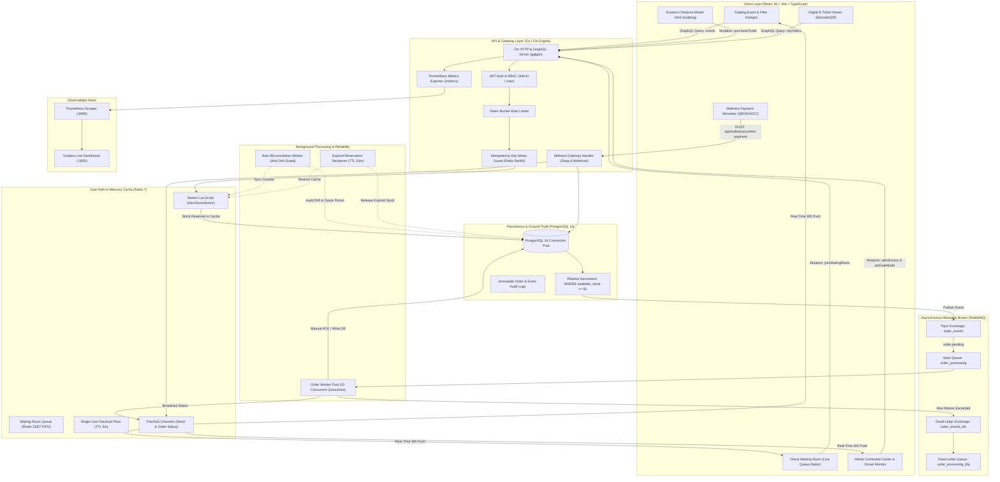

# Detail Teknis Platform Flash Sale dan Tiket Event

Latar belakang masalah dan dampak bisnis dari proyek ini dapat dirujuk pada dokumen Ringkasan.

## Peran dan Lingkup

Lingkup pekerjaan mencakup perancangan dan implementasi teknis menyeluruh dari hulu ke hilir untuk sistem transaksi berkecepatan tinggi:
- Arsitektur backend modular berkinerja tinggi menggunakan Go dengan kerangka kerja Gin dan server GraphQL (gqlgen), terstruktur ke dalam pemisahan modul yang jelas (handler, service, repository interface, model, worker, dan middleware).
- Perancangan skema basis data relasional PostgreSQL dengan empat tabel inti (users, events, orders, dan order_logs) disertai migrasi terkelola (golang-migrate), indeks performa, dan pencatatan audit log tak terubahkan.
- Pengendalian konkurensi stok dua lapis (dual-layer stock locking): fast-path in-memory atomik berbasis skrip Lua Redis (DecrStockAtomic) dan penguncian kondisional ACID di tingkat basis data (UPDATE events SET available_stock = available_stock - $1 WHERE id = $2 AND available_stock >= $1).
- Penjaminan idempotensi mutlak pada mutasi pembelian tiket melalui Idempotency-Key Mutex Guard berbasis Redis SetNX dengan masa simpan dua puluh empat jam.
- Pengendalian lonjakan trafik massal melalui ruang antrean virtual (Virtual Waiting Room) berbasis Redis Sorted Set (ZSET FIFO) dengan radar urutan langsung, token izin belanja sekali pakai (Single-Use Checkout Pass), serta kendali gerbang ganda (mode AUTO dan mode MANUAL Surge Gate).
- Arsitektur pemrosesan pesan asinkron menggunakan RabbitMQ dengan Topic Exchange (order_events), pool sepuluh goroutine pekerja dengan konfirmasi manual (manual ACK), mekanisme retry bertahap tiga kali (exponential backoff), dan isolasi pesan rusak via Dead-Letter Queue (order_processing_dlq).
- Pekerja latar belakang rekonsiliasi mandiri (reconciliation_worker) dengan pendeteksi selisih data (data drift), masa tenggang transaksi aktif (in-flight grace period selama dua menit), serta pembatalan otomatis reservasi kedaluwarsa melebihi sepuluh menit.
- Modul integrasi pembayaran terpadu Midtrans Snap (sandbox/simulator) yang mencakup pembuatan token transaksi Snap, antarmuka pembayaran multi-metode (QRIS, Virtual Account bank, dompet digital, kartu kredit), penanganan notifikasi webhook asinkron, dan endpoint konfirmasi pembayaran atomik.
- Modul tiket digital mandiri (E-Ticket) dengan rendering barcode interaktif dan kode QR unik (TicketBarcode), validasi status tiket (ACTIVE, USED, CANCELLED), serta tanda terima digital.
- Pusat kendali admin (Admin Command Center Dashboard) untuk pemantauan omset riil, volume penjualan, sisa kuota tiket memori, pengendali pelepasan antrean batch (admitUsers), dan peninjauan riwayat siklus hidup transaksi melalui log audit.
- Pembangunan antarmuka web modern berbasis Single Page Application (SPA) menggunakan React 18, TypeScript (strict mode), Vite, TanStack Query, Tailwind CSS, dan langganan WebSocket real-time (graphql-ws).
- Penerapan tumpukan observabilitas terpadu menggunakan pengekspor metrik Prometheus (/metrics), visualisasi dasbor Grafana terkonfigurasi otomatis, pelacakan terdistribusi berbasis Request ID (X-Request-ID), serta otomatisasi pengujian beban k6 dan integrasi berkelanjutan GitHub Actions dengan Go race detector (-race).

## Arsitektur Sistem

Sistem memisahkan jalur cepat reservasi kuota di memori dari jalur penulisan data transaksional di basis data, memanfaatkan pialang pesan untuk memproses beban kerja berat secara asinkron.

### Penjelasan Komponen
1. **Klien Web (React 18 SPA):** Antarmuka pengguna responsif berbasis TypeScript yang mengelola katalog tiket multi-kategori, modal ruang antrean virtual interaktif, formulir pembelian instan, simulator pembayaran multi-kanal, penampil e-tiket berbarcode, dan dasbor analitik admin.
2. **Klien Status Data (TanStack Query & graphql-ws):** Memisahkan penanganan data permintaan sinkron (caching, query revalidation, dan optimistic UI update) dari langganan aliran data real-time berbasis WebSocket untuk perubahan kuota stok dan status pesanan.
3. **Router HTTP dan Gateway (Gin Engine):** Mengatur perutean rute API GraphQL (/query), endpoint pembayaran Midtrans (/api/midtrans/*), playground dokumentasi API, serta scraping metrik Prometheus (/metrics).
4. **Middleware Keamanan dan Penjejakan:** Menginjeksi Request ID unik (X-Request-ID) ke dalam context setiap permintaan, memverifikasi tanda tangan token JWT dengan masa berlaku dua puluh empat jam, serta menegakkan otorisasi peran (Role-Based Access Control) antara akun Administrator dan Pengguna Umum.
5. **Pencegah Banjir Permintaan (Rate Limiter):** Membatasi frekuensi pemanggilan checkout per pengguna (maksimal lima permintaan per sepuluh detik) menggunakan counter berbasis waktu di Redis untuk mencegah spamming tombol beli.
6. **Muteks Kunci Idempotensi (Idempotency Mutex Guard):** Mencegah penciptaan pesanan ganda dari request yang sama menggunakan kunci unik di Redis dengan status awal PROCESSING dan penyimpanan hasil akhir pesanan selama dua puluh empat jam.
7. **Jalur Cepat Memori (Redis Engine):** Menjalankan skrip Lua DecrStockAtomic untuk pemotongan kuota instan tanpa race condition, mengelola antrean FIFO ruang tunggu berbasis Sorted Set, dan menyimpan tiket izin belanja sekali pakai (Single-Use Checkout Pass).
8. **Pialang Pesan Asinkron (RabbitMQ):** Mengelola pertukaran topik order_events, menyalurkan pesanan tertunda ke antrean utama order_processing, dan mengisolasi pesan gagal ke antrean order_processing_dlq.
9. **Pool Pekerja Pesanan (Order Worker Pool):** Kumpulan sepuluh goroutine pekerja independen yang memproses penyelesaian transaksi di latar belakang dengan konfirmasi manual (manual ACK), prefetch QoS terkontrol, dan penanganan graceful shutdown.
10. **Pekerja Rekonsiliasi Otomatis (Reconciliation Worker):** Rutinitas latar belakang berkala (interval satu menit) yang mengaudit keselarasan antara kuota di memori Redis dengan total tiket terkonfirmasi di PostgreSQL, dilindungi masa tenggang transaksi (in-flight grace period).
11. **Pelepas Reservasi Kedaluwarsa (Expired Reservation Reclaimer):** Mengidentifikasi pesanan berstatus PENDING yang melampaui batas waktu sepuluh menit, membatalkan status pesanan, serta mengembalikan kuota tiket ke basis data dan cache secara otomatis.
12. **Basis Data Transaksional (PostgreSQL 16 Pool):** Penyimpan persisten utama dengan connection pool (pgxpool) yang menegakkan konsistensi ACID melalui klausa SQL kondisional relatif serta menyimpan riwayat audit log transaksi yang tidak dapat dimanipulasi.
13. **Modul Gerbang Pembayaran Midtrans:** Mengelola siklus transaksi pembayaran mulai dari pembuatan token Snap, verifikasi notifikasi webhook, hingga konfirmasi pembayaran atomik.
14. **Tumpukan Observabilitas (Prometheus & Grafana):** Memantau metrik performa aplikasi internal setiap dua detik dan menyajikannya dalam grafik visual terpusat.

## Keputusan Teknis dan Tantangan

### 1. Penguncian Kuota Cepat Menggunakan Skrip Lua Redis Atomik (DecrStockAtomic)
- **Masalah:** Ketika ribuan pengguna mencoba membeli tiket pada detik yang sama, kueri pembaruan langsung ke basis data relasional memicu antrean kunci baris (row-lock contention), latensi tinggi, serta kondisi perebutan data (race condition) yang berisiko membuat stok bernilai negatif.
- **Keputusan:** Pemotongan stok dieksekusi terlebih dahulu di memori Redis menggunakan skrip Lua tunggal bernama DecrStockAtomic. Skrip ini memeriksa ketersediaan kuota dan melakukan pengurangan secara atomik sebelum transaksi menyentuh basis data.
- **Alasan dan Trade-off:** Karena Redis memproses perintah secara berurutan dalam satu utas utama, skrip Lua menjamin eksekusi atomik tanpa celah interupsi antar-goroutine dan selesai dalam hitungan mikrodetik. Trade-off yang diambil adalah diperlukannya mekanisme kompensasi balik jika proses penyimpanan pada tahap berikutnya mengalami kegagalan.
- **Bukti:** Diterapkan pada fungsi DecrStockAtomic di paket redisclient. Pengujian integrasi paralel 50 goroutine memperebutkan 10 tiket menghasilkan tepat 10 transaksi sukses dan 40 penolakan. Pada uji beban 500 pengguna serentak yang memperebutkan 100 tiket, sistem menyaring transaksi dengan sisa kuota tepat bernilai 0 tanpa ada kelebihan penjualan.

### 2. Proteksi Lapis Kedua dengan Pengurangan Relatif Kondisional di PostgreSQL
- **Masalah:** Ketergantungan eksklusif pada cache memori berisiko memicu divergensi data (data drift) terhadap data fisik jika terjadi gangguan jaringan antara layanan aplikasi dan basis data utama atau restart tak terduga pada server cache.
- **Keputusan:** Menerapkan lapisan verifikasi kedua pada basis data PostgreSQL menggunakan pembaruan relatif berklausa ketat:
  UPDATE events SET available_stock = available_stock - $1, updated_at = NOW() WHERE id = $2 AND available_stock >= $1.
  Jika jumlah baris yang terpengaruh bernilai nol, sistem langsung melakukan pembatalan pesanan, mengeksekusi pengembalian kuota ke Redis (IncrStock), dan mencatat log audit pembatalan kuota habis.
- **Alasan dan Trade-off:** Menjadikan basis data relasional sebagai sumber kebenaran mutlak yang terlindungi secara hukum ACID tanpa perlu mengunci seluruh tabel. Trade-off yang muncul adalah adanya biaya kompensasi rollback jika terjadi ketidaksesuaian antara memori dan penyimpanan permanen.
- **Bukti:** Diimplementasikan pada metode DeductAvailableStock di repository event. Pengujian integrasi memverifikasi bahwa kegagalan kuota di basis data secara otomatis mengembalikan stok di Redis. Hasil kueri verifikasi pasca uji beban menunjukkan status pesanan terkonfirmasi tepat 100 dan sisa stok fisik tepat 0.

### 3. Pemisahan Jalur Transaksi Kritis Menggunakan Antrean RabbitMQ
- **Masalah:** Memproses seluruh tahapan transaksi (validasi, pencatatan persisten, pembuatan tagihan, dan notifikasi) dalam satu panggilan HTTP sinkron menyebabkan waktu tunggu respons pengguna melonjak drastis saat terjadi lonjakan pengunjung.
- **Keputusan:** Membagi alur transaksi menjadi dua: jalur kritis (reservasi kuota memori, pembuatan catatan pesanan berstatus pending, dan pengiriman respons cepat) serta jalur sekunder (pemrosesan akhir yang dialirkan ke antrean RabbitMQ order_processing untuk dikonsumsi worker pool).
- **Alasan dan Trade-off:** Menjaga responsivitas antarmuka pengguna agar tetap berada dalam ratusan milidetik dan melindungi basis data dari beban penulisan serentak. Trade-off yang terjadi adalah sistem beralih ke konsistensi eventual (eventual consistency), di mana pengguna menerima status sementara sebelum menerima konfirmasi final melalui siaran WebSocket.
- **Bukti:** Diterapkan pada kelas OrderWorkerPool dengan 10 goroutine paralel, menerapkan konfirmasi manual (msg.Ack(false)) dan pembatasan prefetch QoS (numWorkers * 2). Latensi median tetap terjaga pada angka 276 milidetik dalam skenario beban bertahap k6.

### 4. Toleransi Kegagalan dengan Dead-Letter Queue dan Percobaan Ulang Bertahap
- **Masalah:** Gangguan sementara pada komponen hilir dapat menggagalkan pemrosesan pesanan pada antrean asinkron, yang jika tidak ditangani dengan benar dapat menghilangkan data pesanan atau memicu perulangan galat tanpa henti (poison pill).
- **Keputusan:** Membangun Dead-Letter Exchange (order_events_dlx) dan Dead-Letter Queue (order_processing_dlq). Pesan yang gagal diproses diberikan kesempatan percobaan ulang hingga 3 kali dengan jeda waktu meningkat bertahap (exponential backoff). Pesan yang tetap gagal setelah 3 kali dialihkan secara otomatis ke antrean dead-letter dan dicatat dalam riwayat audit.
- **Alasan dan Trade-off:** Mencegah antrean utama tersumbat oleh pesan yang rusak sembari mempertahankan catatan transaksi untuk investigasi teknis. Trade-off yang dihadapi adalah pesan yang berada di antrean dead-letter membutuhkan prosedur rekonsiliasi tersendiri.
- **Bukti:** Terverifikasi pada pengujian TestIntegration_RetryBackoffAndDLQ, di mana pesan yang sengaja digagalkan berhasil melalui retry bertahap dan terkirim rapi ke antrean order_processing_dlq.

### 5. Penjaminan Idempotensi Mutlak Melalui Kunci Idempotensi di Redis
- **Masalah:** Pengguna yang cemas sering kali menekan tombol pembelian berulang kali saat terjadi kelambatan jaringan, yang berisiko menciptakan transaksi duplikat dan menghabiskan kuota tiket secara keliru.
- **Keputusan:** Menerapkan penguncian muteks idempotensi menggunakan perintah SetNX pada Redis dengan status awal PROCESSING. Jika permintaan kedua dengan kunci yang sama terdeteksi, sistem menahan permintaan dan mengembalikan hasil pesanan yang telah terbentuk sebelumnya setelah selesai diproses dengan masa simpan dua puluh empat jam.
- **Alasan dan Trade-off:** Menyaring duplikasi permintaan pada gerbang paling awal sebelum perhitungan kuota dijalankan. Trade-off yang timbul adalah klien harus selalu menghasilkan dan mengirimkan pengidentifikasi unik pada setiap mutasi pembelian.
- **Bukti:** Diimplementasikan pada fungsi AcquireIdempotencyLock dan SaveIdempotencyResult. Pengujian integrasi dengan 10 goroutine simultan yang membawa kunci idempotensi identik membuktikan bahwa hanya tepat 1 pesanan yang terbentuk dan stok tiket hanya berkurang 1.

### 6. Pengaturan Beban Pengunjung Melalui Ruang Antrean Virtual (Redis Sorted Set)
- **Masalah:** Lonjakan pengunjung secara tiba-tiba dapat membanjiri server aplikasi sebelum pengguna sempat berinteraksi dengan halaman acara.
- **Keputusan:** Membangun ruang antrean virtual berbasis Redis Sorted Set (ZSET) dengan skor waktu milidetik saat pengguna masuk untuk menjamin urutan FIFO yang adil. Pengguna yang lolos antrean diberikan tiket izin belanja (single-use checkout pass) dengan masa berlaku lima menit. Penyelenggara dapat mengatur mode gerbang antara otomatis (AUTO) atau penyaringan manual (MANUAL).
- **Alasan dan Trade-off:** Beban trafik ribuan pengunjung diserap dalam struktur memori ringan tanpa menyentuh jalur pemesanan tiket utama. Trade-off yang dialami adalah adanya tahapan menunggu tambahan bagi calon pembeli sebelum diarahkan ke jendela pembayaran.
- **Bukti:** Diterapkan pada fungsi JoinWaitingRoom, AdmitNextBatch, dan HasCheckoutPass. Pengujian komponen antarmuka modal antrean lulus verifikasi, serta pengujian peramban otomatis Playwright membuktikan alur penuh dari masuk ruang tunggu, menerima giliran, hingga menyelesaikan pesanan.

### 7. Pencegahan Data Drift Melalui Pekerja Rekonsiliasi Otomatis dengan In-Flight Grace Period
- **Masalah:** Selisih angka kuota antara data memori dan data fisik dapat terjadi akibat pembatalan pesanan yang tidak terekam sempurna atau gangguan koneksi mendadak.
- **Keputusan:** Menjalankan pekerja latar belakang berkala setiap satu menit yang menghitung tiket berstatus terkonfirmasi di PostgreSQL dan membandingkannya dengan kuota di Redis. Sistem dilengkapi masa tenggang transaksi (in-flight grace period selama dua menit) sehingga tidak akan menaikkan kuota di Redis jika masih ada pesanan aktif yang sedang diproses.
- **Alasan dan Trade-off:** Menjaga keakuratan kuota jangka panjang secara otomatis tanpa campur tangan manual. Trade-off yang ada adalah penambahan beban kueri agregasi berkala pada tabel pesanan di basis data.
- **Bukti:** Terlihat pada berkas reconciliation_worker.go. Pengujian pembatalan reservasi kedaluwarsa berhasil mengembalikan stok tiket secara otomatis, dan verifikasi ground truth pasca uji beban menunjukkan keselarasan sempurna antara total tiket, tiket terjual, dan sisa stok.

### 8. Isolasi Siklus Pembayaran dari Penguncian Kuota Melalui Integrasi Midtrans
- **Masalah:** Pembayaran daring membutuhkan waktu eksekusi eksternal (pengguna membuka aplikasi dompet digital atau perbankan), sehingga mengunci stok tiket secara permanen sebelum pembayaran sah dapat memblokir kuota untuk pembeli lain jika pembayaran diabaikan.
- **Keputusan:** Memisahkan siklus hidup transaksi: saat checkout berhasil, kuota tiket dikunci dengan status pesanan PENDING dan diterbitkan token Snap Midtrans. Jika pembayaran berhasil via webhook atau konfirmasi instan, pesanan diubah menjadi CONFIRMED. Jika pembayaran tidak terselesaikan dalam batas waktu sepuluh menit, pekerja otomatis membatalkan pesanan dan mengembalikan kuota tiket ke peredaran umum.
- **Alasan dan Trade-off:** Memastikan tiket tidak terblokir permanen oleh transaksi yang ditinggalkan pembeli tanpa mengorbankan akurasi ketersediaan kuota. Trade-off: memerlukan sinkronisasi status pembayaran asinkron dan pengelolaan waktu kedaluwarsa pesanan.
- **Bukti:** Endpoint /api/midtrans/snap-token, /api/midtrans/webhook, dan /api/midtrans/confirm-payment pada berkas main.go, serta fungsi CancelExpiredOrders pada checkout service.

### 9. Komunikasi Real-time Dua Jalur Menggabungkan TanStack Query dan GraphQL WebSocket
- **Masalah:** Menampilkan perubahan sisa kuota dan status antrean kepada ribuan pengguna melalui polling HTTP berkala dapat membebani server web dengan jutaan permintaan berulang yang tidak efisien.
- **Keputusan:** Menggabungkan TanStack Query untuk transaksi request-response dengan koneksi persisten WebSocket (graphql-ws) untuk langganan mutasi waktu nyata (stockUpdated dan orderStatusChanged). Backend menyiarkan pesan perubahan status melalui Redis Pub/Sub yang langsung diteruskan ke klien WebSocket aktif.
- **Alasan dan Trade-off:** Menghilangkan overhead polling HTTP dan memberikan pembaruan antarmuka instan dalam hitungan milidetik. Trade-off: memerlukan pemeliharaan status koneksi terbuka (stateful connection) pada server gateway.
- **Bukti:** Diterapkan pada konfigurasi srv.AddTransport(transport.Websocket{}) di server utama, resolver langganan GraphQL, serta pustaka klien graphql-ws pada frontend.

### 10. Pengawasan Transaksi Forensik Melalui Catatan Log Audit yang Tidak Dapat Diubah
- **Masalah:** Pada sistem transaksi berkecepatan tinggi dengan kuota terbatas, sengketa transaksi sering terjadi ketika pengguna mengeklaim telah berhasil membeli tiket padahal kuota telah habis.
- **Keputusan:** Menerapkan tabel buku besar audit append-only (order_logs) yang mencatat setiap peristiwa siklus hidup pesanan beserta muatan datanya (ORDER_CREATED, STOCK_RESERVED, ORDER_AWAITING_PAYMENT, ORDER_CONFIRMED, ORDER_DLQ_ROUTED, DB_STOCK_DEPLETED_ROLLBACK, RESERVATION_EXPIRED, MIDTRANS_PAYMENT_CONFIRMED).
- **Alasan dan Trade-off:** Menyediakan bukti rekonsiliasi yang utuh dan tidak dapat diubah untuk keperluan audit teknis dan penyelesaian sengketa operasional. Trade-off: ukuran tabel log audit bertumbuh lebih cepat dibandingkan tabel transaksi utama.
- **Bukti:** Metode CreateOrderLog dan GetOrderLogsByOrderID pada repository order, serta modal penampil log audit pada dasbor admin.

## Hasil Pengujian dan Observabilitas

### 1. Hasil Uji Beban Nyata (k6 Benchmark)
Pengujian beban dilakukan menggunakan alat uji k6 pada lingkungan perangkat keras prosesor 10-core ARM64 dengan alokasi memori 16 GB, menghubungkan aplikasi Go secara langsung ke kontainer PostgreSQL 16, Redis 7, dan RabbitMQ 3.

| Skenario Pengujian | Beban Pengguna (VUs) | Total Transaksi | Throughput Rata-rata | Latensi Median | Latensi p(95) | Tingkat Galat HTTP | Tiket Terjual | Kelebihan Penjualan (Overselling) |
|---|---|---|---|---|---|---|---|---|
| **Ramp-Up (Peningkatan Bertahap)** | 0 ke 200 pengguna (35 detik) | 2.433 iterasi (4.868 HTTP req) | 138,6 req/s | 276 ms | 1.145 ms | **0,00%** | 500 / 500 tiket | **0 (0%)** |
| **Sudden Spike (Lonjakan Tiba-tiba)** | 10 ke 300 pengguna (2 detik) | 1.503 iterasi (3.008 HTTP req) | 119,4 req/s | 2.468 ms | 4.170 ms | **0,00%** | 500 / 500 tiket | **0 (0%)** |
| **Flash Sale Blitz (Perebutan Kuota Terbatas)** | 500 pengguna serentak | 2.000 iterasi (4.003 HTTP req) | 134,9 req/s | 4.545 ms | 6.887 ms | **0,00%** | 100 / 100 tiket | **0 (0%)** |

### 2. Verifikasi Data Akhir di Basis Data Pasca Uji Blitz
Pemeriksaan integritas data dilakukan langsung pada tabel pesanan dan tabel acara setelah 2.000 percobaan transaksi selesai:
- Status pesanan terkonfirmasi: tepat 100 pesanan dengan total kuantitas 100 tiket.
- Sisa stok tersedia pada tabel acara: tepat 0 tiket dari total 100 tiket awal.
- Permintaan yang ditolak: 1.900 permintaan tertolak secara bersih dengan respons kuota habis tanpa kegagalan sistem internal.
- Angka kelebihan penjualan (overselling): 0 tiket (terbukti nol persen secara matematis).

### 3. Pengujian Fungsional dan Integritas Kode
- **Unit Testing:** Pengujian logika bisnis mencakup perhitungan total harga, penegakan kuota maksimal per akun (max_per_user), validasi status acara, kalkulasi metrik posisi antrean, dan pelepasan reservasi kedaluwarsa lulus pengujian dalam 0,21 detik.
- **Integration Testing dengan Race Detector (-race):** Seluruh skenario konkurensi (50 goroutine pemotongan kuota paralel, 10 goroutine dengan kunci idempotensi identik, pelepasan tiket kedaluwarsa, pemutusan koneksi perantara di tengah transaksi, dan pengalihan ke antrean dead-letter) lulus bersih tanpa adanya peringatan data race.
- **Resolver Testing:** Pengujian GraphQL resolver memvalidasi penegakan otorisasi peran (RBAC) antara akun Administrator dan Pengguna Umum serta penolakan format input tanggal yang tidak valid.
- **Frontend Component & E2E Testing:** Pengujian komponen antarmuka modal checkout, modal antrean, dan modal pembayaran menggunakan Vitest dan React Testing Library lulus dalam 14 milidetik. Satu pengujian penjelajahan pengguna penuh dari antrean hingga transaksi sukses menggunakan Playwright headless browser selesai dalam 1,2 detik.

### 4. Tumpukan Observabilitas
Sistem menyediakan endpoint /metrics yang diekspos langsung oleh aplikasi Go. Prometheus melakukan scraping metrik setiap dua detik untuk memantau frekuensi permintaan HTTP, durasi latensi per rute, sisa kuota tiket di memori, dan kedalaman antrean ruang tunggu. Dasbor Grafana terkonfigurasi otomatis untuk menyajikan visualisasi performa secara langsung.

## Tech Stack

| Lapisan Sistem | Teknologi | Fungsi dalam Proyek |
|---|---|---|
| Bahasa Pemrograman Backend | Go 1.25 | Menangani logika bisnis berkecepatan tinggi, konkurensi goroutine, dan komunikasi jaringan |
| Antarmuka API & GraphQL | Gin Framework & gqlgen | Menyediakan endpoint GraphQL untuk mutasi transaksi, query data, dan langganan WebSocket waktu nyata |
| Basis Data Relasional | PostgreSQL 16 | Menyimpan data persisten pengguna, acara, pesanan, dan catatan audit transaksi sebagai sumber kebenaran |
| Pustaka Koneksi Database | pgx v5 & pgxpool | Menangani koneksi pooling berkinerja tinggi ke basis data PostgreSQL |
| Cache & Jalur Cepat | Redis 7 | Mengelola skrip Lua pemotong stok, antrean ruang tunggu (Sorted Set), muteks idempotensi, dan siaran Pub/Sub |
| Pialang Pesan Asinkron | RabbitMQ 3 | Mendistribusikan beban pemrosesan pesanan ke pool pekerja dan menangani isolasi galat via Dead-Letter Queue |
| Antarmuka Pengguna | React 18 & TypeScript | Membangun antarmuka web interaktif dengan sistem komponen modular dan penanganan tipe data yang ketat |
| Pengelolaan Status Klien | TanStack Query | Menangani caching permintaan GraphQL, sinkronisasi status antarmuka, dan pembaruan optimistik |
| Transportasi Waktu Nyata | graphql-ws | Mengelola koneksi persisten WebSocket dua arah untuk siaran pembaruan stok dan status pesanan |
| Penataan Tampilan UI | Tailwind CSS | Menyediakan sistem desain antarmuka responsif dengan skema warna ungu elektrik dan efek kaca |
| Integrasi Pembayaran | Midtrans Snap Simulator | Menyediakan antarmuka pembayaran multi-metode (QRIS, VA Bank, GoPay, Kartu Kredit) dengan webhook |
| Tiket & Barcode Digital | react-barcode & qrcode.react | Menghasilkan kode batang dan kode QR unik pada e-tiket digital untuk pemindaian akses masuk |
| Pengujian Beban Konkurensi | k6 | Menjalankan skenario uji stres konkurensi tinggi (Ramp-Up, Thundering Herd, dan Flash Sale Blitz) |
| Pengujian Otomatis | Go Test (-race), Vitest, Playwright | Menguji logika bisnis, ketiadaan data race, keabsahan komponen UI, dan alur peramban ujung ke ujung |
| Observabilitas & Monitoring | Prometheus & Grafana | Mengumpulkan metrik sistem secara berkelanjutan dan menyajikan dasbor pemantauan kesehatan aplikasi |
| Lingkungan Layanan | Docker & Docker Compose | Mengemas dan menjalankan seluruh layanan pendukung (basis data, cache, pialang pesan, pemantau) secara seragam |
| Integrasi Berkelanjutan | GitHub Actions | Menjalankan pipeline pengujian otomatis, linting kode, deteksi data race, dan verifikasi build pada alur integrasi kode |

## Keterbatasan dan Rencana Lanjutan

- **Integrasi Pembayaran Produksi:** Implementasi pembayaran saat ini menggunakan lingkungan simulasi dan sandbox penyedia pembayaran Midtrans. Tahap produksi berikutnya memerlukan integrasi akun penyedia pembayaran langsung dengan tanda tangan digital dan validasi webhook bersertifikat bank.
- **Topologi Kluster Infrastruktur:** Redis dan RabbitMQ saat ini beroperasi pada instans tunggal dalam lingkungan kontainer lokal. Rencana lanjutan mencakup implementasi Redis Sentinel atau Redis Cluster serta RabbitMQ Quorum Queues berkeandalan tinggi (High Availability) untuk toleransi kegagalan tingkat pusat data.
- **Dukungan Multi-Penyelenggara:** Sistem saat ini dirancang untuk platform acara tunggal. Pengembangan selanjutnya dapat menambahkan arsitektur multi-tenant dengan partisi data yang terisolasi untuk masing-masing promotor acara.
- **Pembatalan Mandiri oleh Pengguna:** Penanganan pembatalan pesanan saat ini berfokus pada kedaluwarsa batas waktu pembayaran otomatis. Fitur pengajuan pengembalian dana mandiri oleh pembeli dapat ditambahkan sebagai modul terpisah.

## Pembelajaran

- Menghadapi lonjakan trafik masif secara mendadak memerlukan pendekatan pertahanan berlapis (defense-in-depth). Memisahkan gerbang pemotongan kuota cepat di memori dari jalur penyimpanan persisten berhasil mengeliminasi kemacetan basis data secara signifikan.
- Pemanfaatan skrip Lua di dalam Redis memberikan kemampuan transaksi atomik yang sangat efisien untuk operasi perhitungan stok tanpa kerumitan penguncian terdistribusi tradisional, asalkan didukung oleh mekanisme pemulihan stok yang disiplin jika terjadi kegagalan di lapisan berikutnya.
- Penerapan ruang antrean virtual berbasis Redis Sorted Set terbukti efektif meredam lonjakan trafik awal (traffic smoothing) dan memberikan pengalaman pengguna yang tenang melalui transparansi posisi antrean.
- Pengujian konkurensi dan kondisi balapan sejak awal pengembangan dengan Go race detector dan simulasi beban nyata sangat penting untuk memverifikasi keandalan sistem sebelum dioperasikan pada skenario riil.
